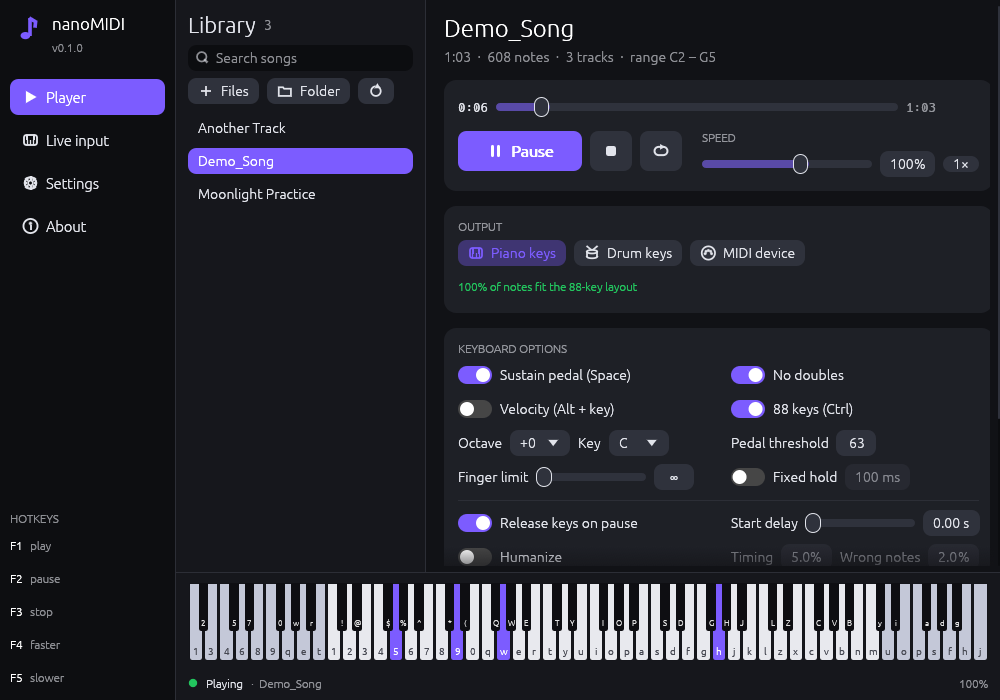

# nanoMIDI

A fast, native MIDI player for virtual pianos and drum kits, written in Rust.
It plays `.mid` files (or a live MIDI keyboard) as keystrokes into the focused
window, or sends them to any MIDI device.

A ground-up rebuild of the ideas in
[nanoMIDIPlayer](https://github.com/NotHammer043/nanoMIDIPlayer) (Python), with
a cleaner UI, faster startup, a smaller footprint and more accurate playback.



## Features

- **Player**: library with search, folder scanning and drag & drop; seek bar,
  loop, speed 10–500 %, optional start countdown, per-track mute.
- **Three outputs**: piano keys (61- or 88-key layout), drum keys (General
  MIDI drum map), or a **MIDI device** (all channels, instruments, controllers
  and pitch bend, with controller state restored when you seek).
- **Keyboard options**: sustain pedal as Space, no doubles (re-press shared
  keys), velocity (Alt + key), 88-key mode (Ctrl + key), octave and key
  transpose, finger limit, fixed hold length, humanize (timing and wrong notes).
- **Fit check**: shows how many notes of the song fit the layout and offers the
  best octave shift in one click.
- **Live input**: a MIDI keyboard types the matching keys, with the same options.
- **Global hotkeys** (F1 play, F2 pause, F3 stop, F4/F5 speed by default), work
  while the game has focus; rebind them by pressing a key in Settings.
- **88-key visualizer** that shows which key each note types.
- Dark, light or system theme, six accent colours, interface scaling,
  always-on-top.
- Editable piano layout, velocity keys and drum kit.
- No telemetry and no network access.

## Compared with the Python version

| | Python original | This version |
|---|---|---|
| Runtime | Python + Tk + several libraries, bundled with PyInstaller | Single native executable (about 6.5 MB on Linux) |
| Startup | Fetches a remote config (5 s timeout) and telemetry at import | Window in about 50 ms, no network |
| Timing | Sleeps in 5 ms steps per message | Every event is scheduled against its absolute time; 1 ms timer resolution on Windows; sleep then spin for the last millisecond |
| Seeking | Not supported | Seek bar; held keys are released and MIDI controllers restored |
| Speed hotkeys | Speed-up and slow-down are swapped | Fixed |
| Velocity | Binary search can pick the wrong level (velocity 5 gives level 3) | Exact 4-wide buckets |
| Finger limit | Counts note-offs, not held keys | Counts held keys |
| MIDI output | Transpose is checked but not applied; note-off can target the wrong note; only notes and sustain sent | Transpose applied; note-offs tracked per channel; all channel messages sent; sustain off and all-notes-off on stop |
| Drums | Hard-coded input library, map built once at import | Uses the same engine and options as the piano; map editable live |
| Config | `~/Documents/nanoMIDIPlayer/config.json` | Platform config dir (`%APPDATA%\nanomidi`, `~/Library/Application Support/nanomidi`, `~/.config/nanomidi`), written atomically; a broken file is backed up and reset |

The default 61-key and 88-key layouts, velocity keys and drum keys match the
original, and its `Documents/nanoMIDIPlayer/Midis` folder is picked up
automatically if it exists.

## Download / build

Pre-built binaries for Windows, macOS and Linux are produced by the GitHub
Actions workflow in `.github/workflows/build.yml` (see the run's artifacts).

To build yourself, install [Rust](https://rustup.rs) and run:

```sh
cargo build --release
# binary: target/release/nanomidi(.exe)
```

Linux needs the ALSA headers to build (`sudo apt install libasound2-dev pkg-config`)
and, at runtime, X11 (`libxkbcommon-x11`). Keystroke simulation and global
hotkeys use X11; under Wayland they only reach XWayland windows.

macOS asks for **Accessibility** permission the first time keys are sent
(System Settings → Privacy & Security → Accessibility).

## Usage tips

- Click a song, switch to the game, press **F1**. Or set a **start delay** and
  use the Play button.
- If notes are missing, check the fit line under *Output* and try the suggested
  octave, or enable *88 keys* if your piano supports Ctrl + key.
- Very short drum notes can be missed by games that poll the keyboard; turn on
  *Fixed hold* (for example 30–60 ms).

## Development

```sh
cargo test                                # mapper, parser, config and real-time engine tests
cargo clippy --all-targets -- -D warnings
cargo fmt
```

Source layout:

| File | Purpose |
|---|---|
| `src/song.rs` | MIDI file parsing, tempo map, merged event list |
| `src/keymap.rs` | Layouts (61/88-key, velocity, drums) |
| `src/mapper.rs` | Note → key events: key ownership, no doubles, sustain, finger limit |
| `src/engine.rs` | Real-time playback thread (clock, seek, speed, humanize, MIDI out) |
| `src/live.rs` | Live MIDI input → keys |
| `src/output.rs` | OS key injection (`enigo`) and MIDI ports (`midir`) |
| `src/hotkeys.rs` | Global hotkeys (`global-hotkey`) |
| `src/config.rs` | Settings file |
| `src/ui/` | egui interface, theme, vector icons, piano widget |
